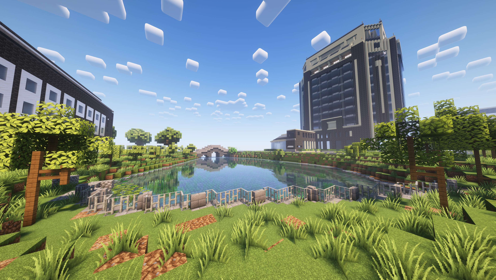

  

<h1 align="center">潮涌核心社 · SHOU Minecraft</h1>

  <strong>生存共建 · 创造建筑 · 校园漫游</strong> 
  记录我们一起建造的世界，也分享海大同学用得上的校园资源。

  
  

  
  
  
  
  

  <a href="https://www.shoumc.com/server/">服务器介绍</a> ·
  <a href="https://www.shoumc.com/community/">社团资源</a> ·
  <a href="https://www.shoumc.com/updates/">更新日志</a> ·
  <a href="https://map.shoumc.com/">在线地图</a>

<em>SHOU 校园湖畔 · 点击图片，进入 BlueMap 漫游。</em>

## 一起建造，也一起记录

从 SMP 的多人生存，到 Create 的自由建筑，再到 SHOU 的校园展示，这里记录服务器介绍、命令说明与更新日志，让新成员找到入口，也让共同完成的作品留下档案。

| 官网 | 文档镜像 | GitHub Pages | 加入交流 |
| --- | --- | --- | --- |
| [www.shoumc.com](https://www.shoumc.com/) | [wiki.shoumc.com](https://wiki.shoumc.com/) | [conduit-club.github.io](https://conduit-club.github.io/) | [Discord](https://discord.gg/knvDenYF5Y) |

## 社团项目与网站

| 项目 | 公开入口 | 源码 |
| --- | --- | --- |
| 水专手册 · SHOU指北 | [在线阅读](https://manual.shoumc.com/) | [SHOU-Online-Manual](https://github.com/Conduit-Club/SHOU-Online-Manual) |
| 今日海大吃什么 | [餐饮指南](https://eat.shoumc.com/) | [SHOU-What-To-Eat](https://github.com/Conduit-Club/SHOU-What-To-Eat) |
| 来选课 · SHOU LXK | [课程评价](https://lxk.shoumc.com/) | [SHOU-LXK](https://github.com/Conduit-Club/SHOU-LXK) |
| 社团统一账号 | [账号中心](https://auth.shoumc.com/) | — |
| SHOU-PCL 社团启动器 | [发行版下载](https://github.com/Conduit-Club/SHOU-PCL/releases/latest) | [SHOU-PCL](https://github.com/Conduit-Club/SHOU-PCL) |
| SHOUConnect | [项目说明](https://www.shoumc.com/community/shou-connect/) | [SHOUConnect](https://github.com/Conduit-Club/SHOUConnect) |
| Paper-YSM | [插件介绍](https://www.shoumc.com/community/paper-ysm/) | [YSM_Paper_Plugin](https://github.com/Conduit-Club/YSM_Paper_Plugin) |
| Discord 娱乐机器人 | [项目介绍](https://www.shoumc.com/community/discord-bot/) | [Discord_Bot](https://github.com/Conduit-Club/Discord_Bot) |

项目用途、维护状态、使用限制与公开页面实拍统一维护在[社团资源文档](https://www.shoumc.com/community/)。

---

发现文档错误或过时链接？欢迎 [提交问题](https://github.com/Conduit-Club/Conduit-Club.github.io/issues) 或补充资料。
